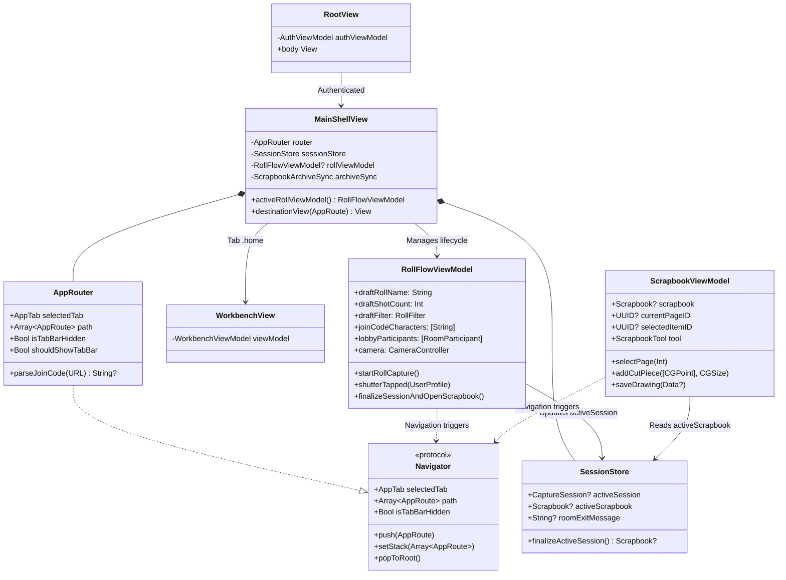
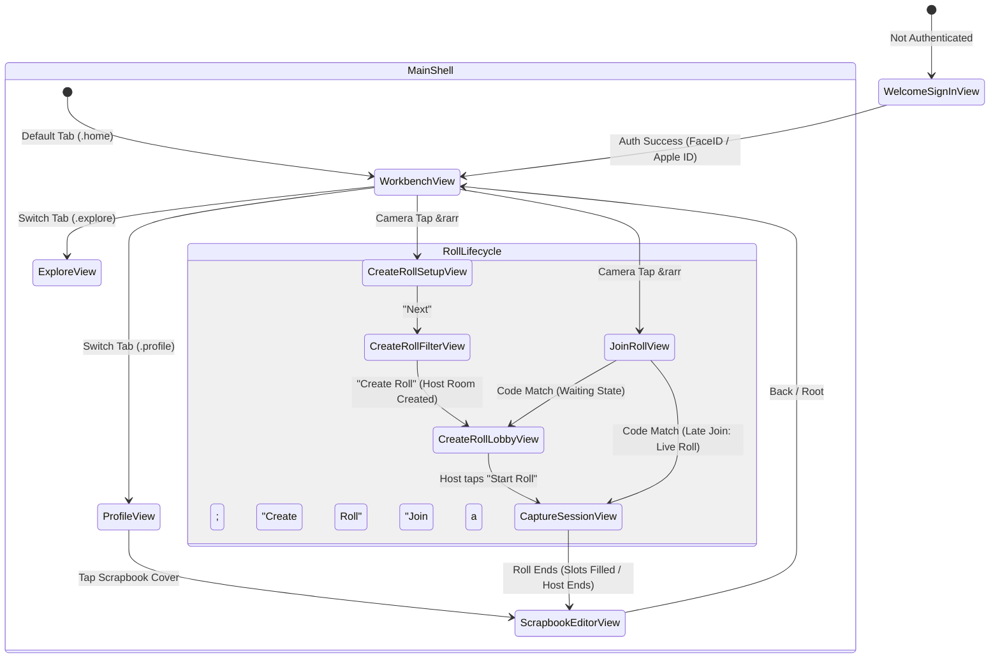
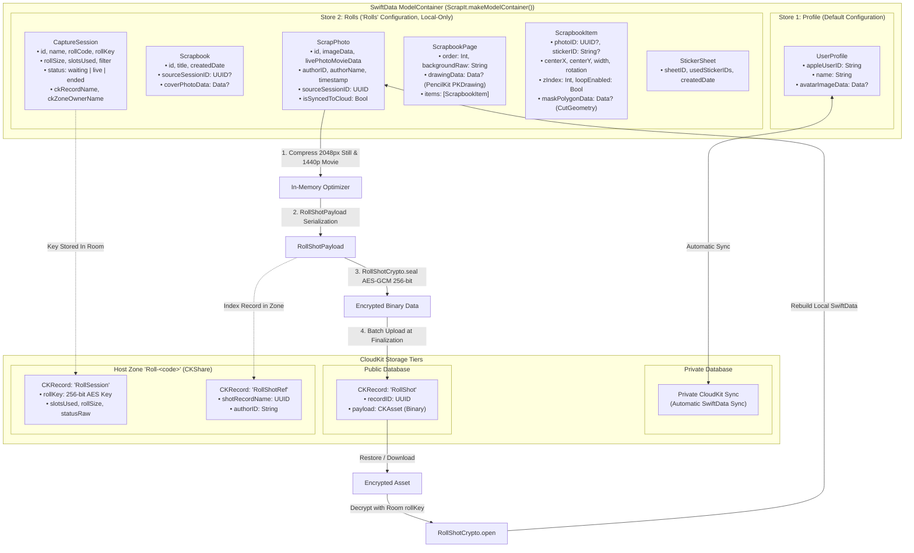
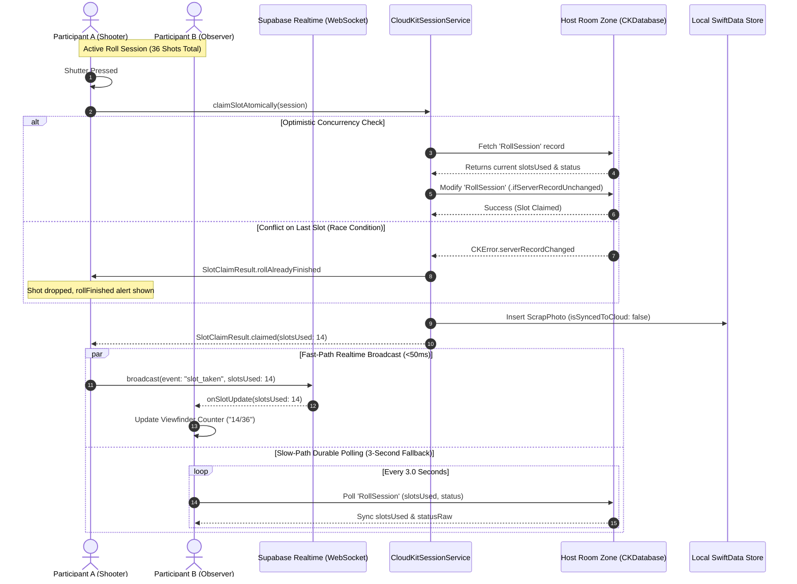
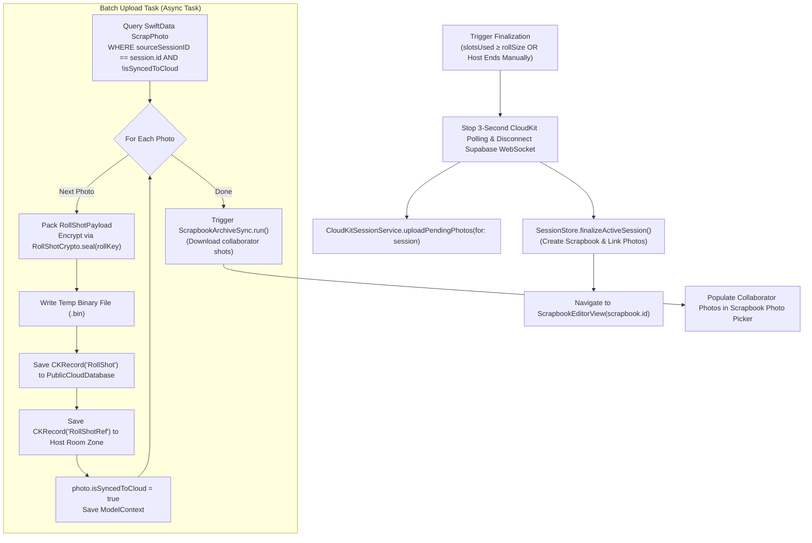
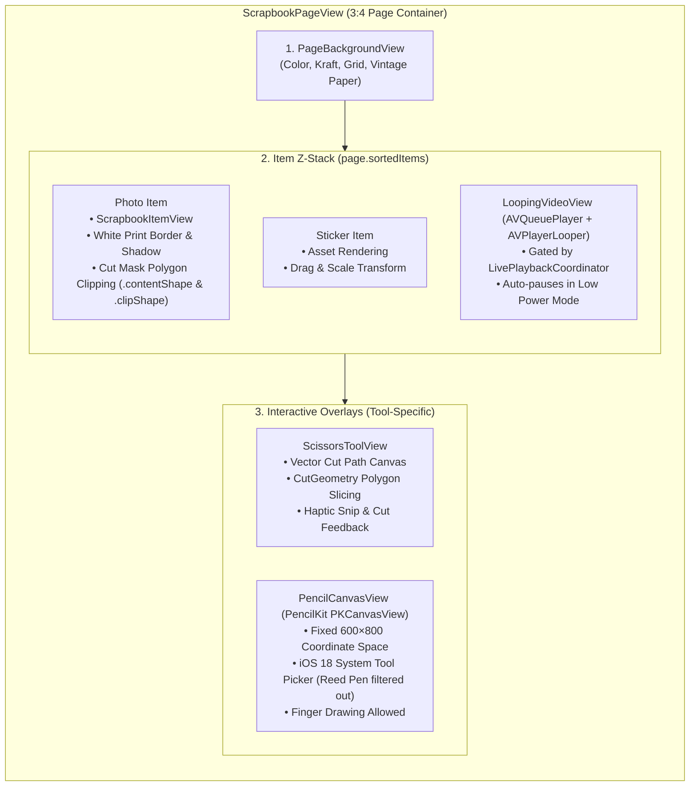

# ScrapIt System Architecture & Technical Specifications

> **ScrapIt** is a collaborative iOS 18+ disposable-camera and digital scrapbooking application built in SwiftUI. It combines real-time shared capture sessions ("Rolls"), private-by-design encrypted CloudKit storage, low-latency Supabase WebSocket broadcasts, custom Metal/AVFoundation camera rendering, and a multi-layer interactive canvas engine (PencilKit, vector polygon clipping, and looping Live Photos).

---

## 1. High-Level System Architecture

ScrapIt operates as a **hybrid decentralized mobile client**, orchestrating three distinct cloud services alongside local on-device hardware engines and persistence layers:

1. **Apple Sign in with Apple & iCloud ID**: Zero-password identity management and credential verification.
2. **CloudKit Tri-Database Model**:
   - **Private Database**: Stores user profile and the host's room zone (`Roll-<code>`) with zone-wide `CKShare`.
   - **Shared Database**: Grants roll participants access to the host's room zone without copying data.
   - **Public Database**: Houses roll code pointers (`RollCode-<code>`) and zero-knowledge encrypted photo blobs (`RollShot`).
3. **Supabase Realtime Service**: Delivers sub-50ms slot count synchronization across shooting participants via WebSocket broadcasts.
4. **On-Device Hardware & Rendering Engines**:
   - **AVFoundation + Metal (`CAMetalLayer`)**: Live filtered camera preview (Aspect Fill, 60fps) and multi-lens virtual zoom.
   - **Core Image (`FilmFilterPipeline`)**: Unified color grading for viewfinder, still capture, and Live Photo movies.
   - **PencilKit + CoreGraphics (`CutGeometry`)**: Freehand vector cutting and stylus/finger drawing layers.

```mermaid
flowchart TB
    subgraph AppleCloud["Apple Cloud Ecosystem"]
        AppleID["Sign in with Apple (ASAuthorization)"]
        subgraph CloudKit["CloudKit Container (iCloud.lepin.scrapit)"]
            subgraph PrivateDB["Host Private Database"]
                ProfileZone["Default Zone: UserProfile"]
                RoomZone["Zone 'Roll-&lt;code&gt;'<br/>• RollSession (Status, Slots, RollKey)<br/>• RollParticipant Records<br/>• Zone-wide CKShare<br/>• RollShotRef Index Records"]
            end
            subgraph SharedDB["Participant Shared Database"]
                AcceptedShare["Mounted 'Roll-&lt;code&gt;' Zone<br/>(Read/Write via CKShare)"]
            end
            subgraph PublicDB["Public Database"]
                RollCodeRecord["RollCode-&lt;code&gt;<br/>(Maps 6-char code &rarr; shareURL)"]
                RollShotRecord["RollShot (UUID)<br/>• payload: AES-GCM Encrypted Blob<br/>(No readable fields / No indexes)"]
            end
        end
        APNs["APNs Remote Notifications<br/>(Silent zone changes)"]
    end

    subgraph SupabaseCloud["Supabase Realtime Cloud"]
        SupaSocket["Supabase WebSocket<br/>Topic: 'roll:&lt;code&gt;'<br/>Event: 'slot_taken' (&lt;50ms)"]
    end

    subgraph iOSClient["ScrapIt iOS Client (iOS 18+)"]
        AppShell["App Shell & Navigation<br/>RootView &rarr; MainShellView &rarr; AppRouter"]
        
        subgraph ViewModels["Feature ViewModels (@Observable)"]
            AuthVM["AuthViewModel"]
            WorkbenchVM["WorkbenchViewModel"]
            RollVM["RollFlowViewModel"]
            ScrapbookVM["ScrapbookViewModel"]
            ProfileVM["ProfileViewModel"]
        end

        subgraph CoreServices["Core Services Layer"]
            SessionStore["SessionStore<br/>(Cross-feature state)"]
            CKService["CloudKitSessionService<br/>(Atomic slot claim & batch upload)"]
            RoomService["CloudKitRollRoomService<br/>(CKShare & zone management)"]
            RealtimeService["SupabaseRollSlotRealtimeService<br/>(WebSocket slot broadcast)"]
            ArchiveSync["ScrapbookArchiveSync<br/>(CloudKit restore & shot download)"]
            CamCtrl["CameraController & CameraEngine<br/>(AVFoundation + Metal PreviewRenderer)"]
            FilterPipe["FilmFilterPipeline & MovieWriter<br/>(Noir / Chrome Core Image & HEVC)"]
        end

        subgraph SwiftDataLayer["SwiftData Persistence (Dual Container)"]
            ProfileStore[("Profile Store<br/>(CloudKit Synced)")]
            RollsStore[("Rolls Store<br/>(Local Only: CaptureSession, Scrapbook,<br/>ScrapPhoto, Pages, Items, Stickers)")]
        end
    end

    %% Wirings
    AuthVM --> AppleID
    AuthVM --> ProfileStore
    
    RoomService --> PrivateDB
    RoomService --> SharedDB
    RoomService --> PublicDB
    APNs -.-> RoomService

    CKService --> PrivateDB
    CKService --> PublicDB
    
    RealtimeService <--> SupaSocket

    RollVM --> CamCtrl
    RollVM --> CKService
    RollVM --> RoomService
    RollVM --> RealtimeService
    RollVM --> SessionStore
    
    ArchiveSync --> RoomService
    ArchiveSync --> RollsStore

    CamCtrl --> FilterPipe
    CamCtrl --> RollsStore
    
    ScrapbookVM --> RollsStore
    ScrapbookVM --> SessionStore
    WorkbenchVM --> SessionStore
    WorkbenchVM --> RollsStore
```

---

## 2. Component Hierarchy & Navigation Wiring

ScrapIt adheres strictly to **Feature-First MVVM** with Swift Observation (`@Observable`). 
- Views are completely decoupled from persistence and networking handles.
- Navigation is handled through the abstract `Navigator` protocol implemented by `AppRouter`.
- ViewModels are initialized at root/shell boundaries and injected into views.

### Route State Machine (`AppRoute`)

---

## 3. Storage & Cryptographic Architecture

ScrapIt implements a **dual-container SwiftData storage architecture** with zero-knowledge AES-GCM encrypted public CloudKit distribution.

### Cryptographic Security Properties
- **Zero-Knowledge Photo Storage**: Photos uploaded to CloudKit's Public Database are sealed via `AES.GCM` with a 256-bit symmetric key (`RollShotCrypto`). The public database has **no indexes** and **no queryable metadata** (no author, no timestamp, no roll ID).
- **Access Control via CKShare**: The decryption key (`rollKey`) is stored exclusively in `RollSession` inside the private zone `Roll-<code>`. Only authenticated participants who have accepted the `CKShare` can read the room zone and retrieve the `rollKey`.
- **Local Layout Isolation**: Scrapbook layout elements (`ScrapbookPage`, `ScrapbookItem`, `drawingData`, scissors cuts) remain strictly local on the editing device to prevent cross-device layout corruption.

---

## 4. Real-Time Hybrid Synchronization Architecture

ScrapIt combines **low-latency WebSocket broadcasts** with **durable CloudKit storage** and **optimistic atomic slot arbitration** to ensure a tamper-proof shared disposable camera experience.

---

## 5. Roll Finalization & Batch Upload Lifecycle (Change 015)

To conserve device bandwidth, prevent partial/abandoned roll clutter in CloudKit, and eliminate shutter latency, photo uploads are completely decoupled from camera capture.

---

## 6. Camera Engine & Media Processing Pipeline

The camera sub-system in ScrapIt provides a custom, hardware-accelerated AVFoundation capture pipeline that pairs an iOS 18 Camera Control surface with real-time Metal-backed Core Image filtering.

```mermaid
flowchart LR
    subgraph HardwareInput["Hardware & User Input"]
        PhysicalLens["Multi-Lens System<br/>(Ultra-Wide 0.5&times;, Wide 1&times;, Tele 2&times;/3&times;/5&times;)"]
        CameraControl["iOS 18 Camera Control<br/>(AVCaptureSlider 'Zoom')"]
        KnurledWheel["Knurled Zoom Wheel<br/>(Logarithmic Travel Math)"]
        VolumeButtons["Hardware Volume Buttons<br/>(AVCaptureEventInteraction)"]
        ShutterBtn["UI Shutter Button"]
    end

    subgraph AVFoundationLayer["AVFoundation Capture Pipeline"]
        AVSession["AVCaptureSession (sessionQueue)"]
        VideoInput["AVCaptureDeviceInput"]
        VideoDataOutput["AVCaptureVideoDataOutput (videoQueue)"]
        PhotoOutput["AVCapturePhotoOutput (processingQueue)"]
        RotationCoord["AVCaptureDevice.RotationCoordinator"]
    end

    subgraph ProcessingPipeline["Core Image & Metal Rendering"]
        CIContextInstance["Shared RenderContext.ciContext (MTLDevice)"]
        FilmPipeline["FilmFilterPipeline<br/>• Noir (Cinematic 400 B&W)<br/>• Chrome (200 Color Print)"]
        PreviewRender["PreviewRenderer<br/>CAMetalLayer (Aspect Fill)"]
        PhotoEncoder["FilmPhotoEncoder<br/>• Proportional Downsample: &le;2048px<br/>• 0.78 JPEG Compression<br/>• Apple MakerNote Identifier '17'"]
        MovieWriter["LivePhotoMovieWriter<br/>• Max 1440p Longest Edge (HEVC)<br/>• ~2.5 Mbps Target Bitrate<br/>• QuickTime Metadata Pairing"]
    end

    subgraph OutputSurfaces["Outputs"]
        LiveViewfinder["Live Screen Viewfinder (Filtered Preview)"]
        StillData["ScrapPhoto.imageData"]
        MovieData["ScrapPhoto.livePhotoMovieData"]
    end

    %% Wirings
    PhysicalLens --> VideoInput
    VideoInput --> AVSession
    AVSession --> VideoDataOutput
    AVSession --> PhotoOutput
    
    CameraControl <-->|Bi-directional Sync| KnurledWheel
    KnurledWheel --> VideoInput
    VolumeButtons --> ShutterBtn
    ShutterBtn --> PhotoOutput

    VideoDataOutput -->|CMSampleBuffer &rarr; CIImage| FilmPipeline
    FilmPipeline -->|Display on Video Queue| PreviewRender
    PreviewRender --> LiveViewfinder

    PhotoOutput -->|Filtered Still CIImage| PhotoEncoder
    PhotoEncoder --> StillData

    PhotoOutput -->|Paired QuickTime Movie| MovieWriter
    MovieWriter --> MovieData
```

---

## 7. Scrapbook Interactive Canvas Engine

The digital scrapbook is an interactive multi-layer compositor rendering at a 3:4 aspect ratio.

### Freehand Scissors Cutting Algorithm (`CutGeometry`)
When scissors are dragged across a photo, `CutGeometry` executes a 2D computational geometry sequence:
1. **Ramer-Douglas-Peucker Simplification**: Compresses the user's high-frequency finger path within a tolerance boundary.
2. **Ray-Segment Intersection**: Identifies entry and exit crossing points along the polygon perimeter.
3. **Polygon Bisection**: Divides the original `[CGPoint]` coordinate list into two child polygons along the cutting chord.
4. **Minimum Area Validation**: Drops degenerate pieces ($< 2\%$ of the original area) to preserve layout stability.
5. **SwiftData Mutation**: Replaces the source item with the first piece and inserts the second piece at an offset position with preserved rotation.

---

## 8. Complete System Wiring & Layer Matrix

The following matrix maps every primary source file in the ScrapIt project to its architectural layer, dependencies, and behavioral responsibilities:

| Layer | File / Type | Dependencies / Imports | Core Responsibility |
| :--- | :--- | :--- | :--- |
| **App Shell** | `ScrapIt.swift` | `SwiftData`, `SwiftUI` | Dual-store `ModelContainer` creation (Profile = CloudKit; Rolls = Local); App entry point. |
| **App Shell** | `AppDelegate.swift` | `CloudKit`, `UIKit` | APNs silent push registration (`.rollRoomDidChange`), `OrientationLock` enforcement, scene delegation. |
| **App Shell** | `CloudKitShareHandling.swift` | `CloudKit`, `Observation` | `IncomingShareInbox` and `ShareAcceptingSceneDelegate` for processing universal iCloud share links. |
| **App Shell** | `RootView.swift` | `SwiftData`, `SwiftUI` | Authentication gating; launches `AuthViewModel.restoreExistingSession()`. |
| **App Shell** | `MainShellView.swift` | `SwiftData`, `SwiftUI` | Primary container holding `NavigationStack`, `FloatingTabBarView`, deep-link listener, and route resolution. |
| **Navigation** | `AppRouter.swift` | `Observation`, `Foundation` | Implements `Navigator`; maintains navigation stack `[AppRoute]`, tab selection, and join code URL parsing. |
| **Navigation** | `NavigationRoutes.swift` | `Foundation` | Enums `AppTab` and `AppRoute` defining navigation destinations. |
| **Cross-Cutting**| `SessionStore.swift` | `Observation`, `SwiftData` | Bridges state across Roll, Home, and Scrapbook features without direct cross-feature coupling. |
| **Service (Room)**| `RollRoomService.swift` | `CloudKit`, `OSLog` | Manages CloudKit zones (`Roll-<code>`), `CKShare`, participant records, and public roll codes. |
| **Service (Sync)**| `CloudKitSessionService.swift`| `CloudKit`, `Network` | Atomic slot claims (`.ifServerRecordUnchanged`), batch photo upload, offline queue, and status polling. |
| **Service (Live)**| `RollRealtimeService.swift` | `Supabase` | Sub-50ms WebSocket slot broadcasting (`slot_taken`) on channel `roll:<code>`. |
| **Service (Crypto)**| `RollShotCrypto.swift` | `CryptoKit`, `Foundation` | AES-GCM 256-bit encryption/decryption of `RollShotPayload` blobs. |
| **Service (Restore)**| `ScrapbookArchiveSync.swift`| `SwiftData`, `CloudKit` | Reconciles finished rolls from CloudKit, decrypts remote shots, and populates local scrapbooks. |
| **Service (Camera)**| `CameraController.swift` | `Observation`, `AVFoundation`| Main-actor interface managing camera lifecycle, flash, zoom, and hardware interactions. |
| **Service (Engine)**| `CameraEngine.swift` | `AVFoundation`, `CoreImage` | Background queue AVFoundation session, multi-lens switching, Camera Control slider, and delegates. |
| **Service (Filter)**| `FilmFilterPipeline.swift` | `CoreImage`, `Metal` | Applies Noir / Chrome CIFilters across viewfinder, still photo, and Live Photo movie. |
| **Service (Video)** | `LivePhotoMovieWriter.swift` | `AVFoundation` | Transcodes paired QuickTime Live Photo movies to HEVC 1440p / 2.5 Mbps with metadata pairing. |
| **Service (Metal)** | `PreviewRenderer.swift` | `Metal`, `QuartzCore` | Low-latency 60fps GPU frame display on `CAMetalLayer` with aspect fill. |
| **Service (Math)** | `CutGeometry.swift` | `CoreGraphics` | Freehand path simplification and polygon splitting math for the scissors tool. |
| **Service (Cache)**| `LiveMovieFileCache.swift` | `Foundation` | Caches Live Photo movie bytes from SwiftData to temporary disk URLs for AVPlayerLooper. |
| **Service (Coord)**| `LivePlaybackCoordinator.swift`| `Observation`, `UIKit` | Gates Live Photo playback based on Low Power Mode and app foreground status. |
| **Service (Auth)** | `AppleCredentialChecker.swift`| `AuthenticationServices` | Verifies Apple ID credential status against `ASAuthorizationAppleIDProvider`. |
| **Feature: Auth** | `AuthViewModel.swift` | `Observation`, `SwiftData` | Handles Apple Sign-In flow, credential persistence, offline launch fallback, and sign-out. |
| **Feature: Home** | `WorkbenchViewModel.swift` | `Observation`, `SwiftData` | Drives flat-lay desk interactions, camera pop-up animation, and scrapbook cover selection. |
| **Feature: Roll** | `RollFlowViewModel.swift` | `Observation`, `SwiftData` | Central coordinator for create, join, lobby, shutter capture, slot syncing, and roll finalization. |
| **Feature: Scrapbook**| `ScrapbookViewModel.swift` | `Observation`, `SwiftData` | Drives page manipulation, item transforms, scissors cutting, PencilKit drawings, and sticker sheets. |
| **Feature: Profile**| `ProfileViewModel.swift` | `Observation`, `SwiftData` | Displays scrapbook shelf/grid, handles local scrapbook deletion and tombstoning. |
| **Design System** | `DSColor.swift` | `SwiftUI` | Figma-accurate design tokens for Brand, State, Component, and Paper palettes. |
| **Design System** | `DSTypography.swift` | `SwiftUI` | Line-height scaled typography for SF Pro and Architects Daughter custom fonts. |
| **Design System** | `ScrapbookPageView.swift` | `SwiftUI` | Multi-layer 3:4 canvas rendering background, cut items, looping videos, and drawing strokes. |
| **Design System** | `ScissorsToolView.swift` | `SwiftUI` | Interactive scissors gesture controller, dashed cutting line canvas, and snip haptics. |
| **Design System** | `PencilCanvasView.swift` | `PencilKit`, `SwiftUI` | PencilKit canvas wrapper supporting iOS 18 tool picker (reed pen filtered) and touch input. |

---

## 9. Key Architectural Guarantees & Constraints

1. **Strict Dumb Views**: Views contain zero business logic, networking, or SwiftData persistence queries (`@Query` or `modelContext.fetch`). All user interactions forward to ViewModel methods.
2. **Testable ViewModels**: ViewModels strictly avoid importing `SwiftUI`, ensuring unit testability against simulated services and mock models.
3. **Decoupled Cross-Feature Communication**: Features never import each other. Cross-feature navigation is routed through `Navigator`, while shared session state is synchronized via `SessionStore`.
4. **Orientation Invariant Enforcement**: The capture session is strictly locked to landscape via `OrientationLock` and `AppDelegate.supportedInterfaceOrientationsFor`, while all other app screens remain portrait-locked.
5. **Offline Resiliency & Graceful Degradation**:
   - If CloudKit setup fails, `ScrapIt.makeModelContainer()` seamlessly falls back to a local-only SwiftData store.
   - If Supabase WebSocket connection drops, slot synchronization falls back to the 3-second CloudKit polling loop.
   - If network connectivity is lost while shooting, captured photos are safely queued in SwiftData and batch-uploaded upon roll conclusion when reconnected.